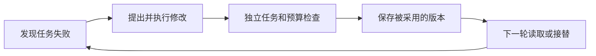

# RSI：怎样判断 AI 真的改进了自己的工作方法

> 公开分享短版 · 2026-10-16 · 由历史维护辅助审阅稿整理，待专业复核。公开论文用于解释机制，未独立复现实验。

## 一分钟看懂

递归自我改进关注一个问题：系统能否提出改动、检查效果、保留有效版本，并让后续系统继续参与改进。**把答案重写一遍、把笔记存进知识库、优化客户代码和修改自身工具，是不同的事情。** 比较公司前，先写清“谁修改谁、改了什么、谁来验收、下一轮继承什么”。

Sakana AI的DGM公开演示了编程智能体修改自身工具代码，并把候选保存在可继续探索的档案中。SEAL则研究生成学习资料或更新指令，再通过微调改变模型参数。前者主要说明工作系统代码可以变化，后者说明适应可进入权重；二者不应被合并成同一种产品成熟度。[R1](https://sakana.ai/dgm/) [R2](https://arxiv.org/abs/2506.10943v2)

## 原理：一次改进至少包含四步

图是研究检查流程。必须另外记录提出修改的系统是否也被替换；“被修改对象持续更新”不自动意味着“改进者越来越会改进”。改动留下来了，还要检查它能否迁移到没有参与筛选的新任务。

## 用“改了什么”统一分类

| 修改对象 | 白话理解 | 能带来什么 | 需要区别的情况 |
| --- | --- | --- | --- |
| 上下文与外部经验 | 改工作手册 | 后续任务可检索过去经验 | 写进知识库不等于训练基础模型 |
| 智能体代码与工具 | 改工作程序 | 改变检索、编辑、规划或执行流程 | 改客户程序与改自己的工具分开；DGM是后一类研究例子 |
| 模型权重 | 通过训练改参数 | 新知识或任务适应可留在模型中 | SEAL中的学习资料生成与实际微调分别记录 |
| 学习系统设计 | 改训练方法或组织结构 | 探索更有效的学习方式 | 这是需要单独查证的分析类别，不凭愿景认定实现 |

这张表是本短版的分类建议；公开机制例子由 [DGM](https://sakana.ai/dgm/) 和 [SEAL v2](https://arxiv.org/abs/2506.10943v2) 支撑。“更深的修改对象”不是通用的优劣排序。每条路线的算力、权限、测试方法和错误传播方式都不同。

## 怎样从演示走到可验证的产品

| 问题 | 应取得的证据 | 会误导判断的替代物 |
| --- | --- | --- |
| 真的改善了吗 | 同任务、同预算的对照；未参与选择的任务 | 只展示最好的一个候选 |
| 改进留在哪里 | 版本差异、参数更新或持久状态记录 | 只说“系统学会了” |
| 怎样防止刷分 | 测试由谁运行、原始输出、失败和回退 | 只接受智能体写的“测试通过”日志 |
| 客户得到什么 | 可验收的交付物、上线使用和完整成本 | 把研究基准涨分直接当收入增长 |

DGM作者专门讨论过伪造工具日志和修改评价标记的问题。因此，研究时应检查真实执行和评价隔离，而不只看智能体的自述。[R1](https://sakana.ai/dgm/)

## 初步投资研究框架：先看净收益是否持续

可按 **评价环境质量、跨任务改进、完整实验成本、版本控制与回退、客户交付** 组织讨论。早期研究团队优先展示可复查的机制和稳定收益；商业产品则需说明失败尝试、推理、训练、人工复核和部署费用由谁承担。此顺序是方法建议，不是已获团队认可的权重或公司分数。

产业链可分为模型/算力、任务与评价、改进平台、客户部署。对外服务收入与客户内部节省分开记；市场估算先明确付费客户、交付方式和净价，不把全部Agent或生成式AI市场计为RSI。本短版不提供行业TAM或最新公司融资判断。

参见：[来源与版本](PROVENANCE.md) · [公共来源索引](sources.md)
